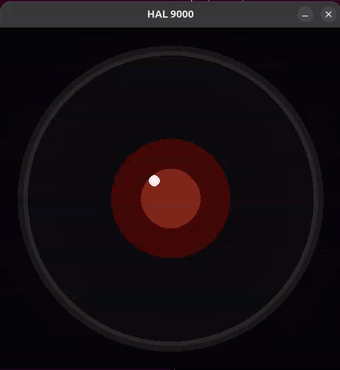

# hal-voice


> *"I am completely operational, and all my circuits are functioning perfectly."*

Talk to Hal and have it answer out loud, in the voice of HAL 9000, with a red lens watching you
from the corner of the screen. Speech recognition and synthesis always run on your own machine; the
thinking is done by core Hal's local brain with the tools of your installed extensions, or by
whatever [Claude Code](https://claude.ai/code) you already have.



## Highlights

- **It starts speaking before it's finished thinking.** Replies are synthesised sentence by sentence
  as they're generated, so you hear the first words in about a second rather than waiting for the
  whole answer.
- **Talk at a normal pace.** Say "Hal" at the start or end of a sentence and the request is heard in
  the same breath; after he answers, carry on for a few seconds without his name.
- **A boxed local brain with tools.** In `hal` mode (the default) Hal's sandboxed assistant agent
  answers with a local model and calls tools only through Hal's broker. Claude Code is never called
  unless you set `brain.mode: claude`.
- **Interrupt it whenever you like**: say his name while he talks and he stops to listen.
- **A red eye that reacts** - idle, listening, thinking, speaking.
- **Your voice never leaves the machine.** Speech recognition and synthesis are both local. What
  Claude Code does with the transcript is between you and your existing setup.
- **Works with the Claude Code you already have.** No model to install, nothing to configure -
  clone it and talk. Point it at a local model later if you want to.
- **Drop it into a normal session.** Run it as an MCP server and get speak/listen as tools inside a
  regular Claude Code session, without the full voice loop.
- **Bring your own voice.** Train it on any voice data you have the rights to.
- **One config file**, with environment variable overrides for everything in it.

## Overview

```
"Hal, ..."  ->  faster-whisper  ->  core Hal's brain + hal-hub tools (or Claude Code)
                                              v
                     speakers  <-  FX chain  <-  GPT-SoVITS
```

You say HAL's name (or hold a key), ask a question, and it answers aloud. Underneath, speech is
transcribed with faster-whisper, handed to the brain, and the reply is streamed back out through
GPT-SoVITS and a small effects chain that gives it the right weight and room.

hal-voice runs **no language model of its own**. It is a voice on the front of a brain: Hal's
boxed agent in `hal` mode, or a headless Claude Code session in `claude` mode.

### Author

Built by [@NotEoin](https://github.com/NotEoin).

### Pointing it at a project

In `claude` mode, Claude Code is launched *inside a directory*, and picks up that directory's
`CLAUDE.md`, `.mcp.json` and `.claude/` settings automatically. By default that is the vault named in
`~/.config/hal/config.toml` (`[hal].vault`), else the current directory. To choose another:

```bash
./hal-voice --project ~/code/my-project   # HAL gains that project's memory and tools
./hal-voice connection                    # show what it resolved, and why
```

Set it permanently as `claude.project_dir` in `~/.config/hal-voice/config.yaml` (see
[Configuration](#configuration)).

### Choosing a brain

`brain.mode` decides who answers:

- `hal` (the default) is an ACP client of `hal acp --channel voice --toolset assistant`: Hal's boxed
  assistant agent answers, with the local model reached through the gateway and tools through the
  broker. The command is `brain.hal_command`. When a tool call needs approval, HAL reads out the
  host's summary and needs a spoken "yes" or "allow" (the whole reply) within 20 s; anything else,
  or `brain.voice_approvals: false`, denies. If `hal` is missing or exits twice, hal-voice stops
  with an error; it never falls back to another brain. Checked by `tests/test_acp_brain.py`.
- `openai` streams the reply from any OpenAI-compatible server (llama-server, Ollama's `/v1`, vLLM, a
  hosted API) at `brain.base_url`, with no tools. It is for running hal-voice without Hal. There is
  no default URL: with `base_url` empty, hal-voice stops and says which key to set. A bearer token,
  if the server needs one, is read from the file `brain.api_key_file`. HAL remembers the last
  `brain.history_turns` exchanges (8 when empty), and a reply still unfinished after
  `brain.turn_timeout_s` (300 s) ends with "That took too long".
- `claude` runs Claude Code for every turn, so HAL has that project's full toolset and memory, at the
  cost of a few seconds' start-up per turn. Claude Code runs on the host, outside Hal's sandbox, and
  hal-voice logs a warning saying so at start. `claude.permission_mode` defaults to `default`, so
  headless Claude Code refuses anything that needs a permission; set `acceptEdits` to let it change
  files. A turn still running after `brain.turn_timeout_s` (300 s) is killed with its child
  processes, and HAL says "That took too long".

```yaml
# ~/.config/hal-voice/config.yaml: a local llama-server, no Hal
brain:
  mode: openai
  base_url: http://127.0.0.1:8080/v1
```

```bash
HALVOICE_BRAIN_MODEL=mistral-small3.2:24b ./hal-voice   # another model, for this run only
HALVOICE_BRAIN_MODE=claude ./hal-voice                  # Claude Code for every turn
```

The `direct` mode and the `brain.fallback` idea are gone: a brain that cannot start stops
hal-voice with an error naming the mode and the fix. The keys `brain.ollama_url`, `keep_alive`,
`max_tool_rounds`, `tools_per_turn`, `num_ctx`, `temperature`, `hub_path` and `ui.rgb_follow` were
removed with it; the model and its limits are Hal's settings now.

In `claude` mode it can also follow a [Hal](https://github.com/NotEoin/Hal) install's profile: point
`claude.hal_root` at a checkout with a `hal.conf` (or run `./setup-voice.sh --hal auto`). To plug into
a setup that isn't Hal, set `claude.env_file` to any `KEY=VALUE` file of `ANTHROPIC_*` settings.

## Usage

```bash
./hal-voice doctor       # check your audio devices, models and TTS server
./hal-voice              # start the voice loop
./hal-voice tts "hello"  # speak one line, no mic or model needed
./hal-voice mcp          # run just the speak/listen MCP server
./hal-voice eye          # run the eye on its own
./hal-voice connection   # show which Claude Code setup it will drive, and why
bin/hal-say "hello"      # speak a line if the voice server is up; silent in quiet hours
```

Through hal-hub, other modules and the brain can speak with the `voice_say` tool.

**Run `doctor` first.** Almost every problem in a voice pipeline turns out to be an audio device
problem, and it'll tell you in two seconds.

Hold **space** to talk, release to send. Speaking again while it's replying interrupts it.

### Configuration

Every setting and its default is in [`halvoice/config.yaml`](halvoice/config.yaml) - audio devices,
activation, model choices, voice tuning, the effects chain and the eye. Leave that file alone and
put only the keys you change in your own file, with the same layout:

```yaml
# ~/.config/hal-voice/config.yaml
audio:
  input_device: 3
stt:
  model: small.en
```

Settings load in this order, later wins:

1. `halvoice/config.yaml`, the packaged defaults;
2. `~/.config/hal-voice/built.yaml`, written by the voice build (`make-hal-voice`) or by
   `hal-voice config import-built OLDFILE` from an older checkout's `config.yaml`;
3. `~/.config/hal-voice/config.yaml`, or the file `HALVOICE_CONFIG` names;
4. environment variables `HALVOICE_<SECTION>_<KEY>`.

`~/.config` stands for `$XDG_CONFIG_HOME` when that is set. A key in either file that the defaults
do not have stops hal-voice with an error naming the file and the key, so a typo cannot be silently
ignored. `python -m halvoice.config` prints the merged result and the files it read.

```bash
HALVOICE_TTS_SPEED=0.9 ./hal-voice        # slow it down, for this run only
HALVOICE_STT_MODEL=medium.en ./hal-voice  # more accurate transcription
```

### Testing hands-free listening

`voicetest` replays a recording of you reading [`voicetest/script.txt`](voicetest/script.txt)
through the same voice detector, name rules and speech recognition the service uses, without the
voice or the brain, and reports what woke HAL, what reached him and how fast:

```bash
./hal-voice voicetest split ~/recording.wav    # cut it into lines (kept in voice-data/tests/)
./hal-voice voicetest run                      # replay on a simulated clock, in a minute or so
./hal-voice voicetest run --live               # replay at real-time pace through the threads
./hal-voice voicetest run --simulate --set activation.keyword.end_silence_ms=500 --label e500
./hal-voice voicetest compare sim e500         # two runs side by side
./hal-voice voicetest brain --label sim        # send the commands heard to a model; tool calls are recorded, never run (see --manifest)
```

Record on the microphone HAL uses, with HAL turned off, saying "Marker one" and the take ("Desk,
take one") first. `--simulate` adds louder fans and a quieter voice, made from your recording,
until you have recorded those takes. The clips are your voice, so they stay out of git.

## Installation

hal-voice is a Hal ecosystem extension: it lives in `extensions/hal-voice` and is installed by the
ecosystem installer, which also renders its systemd units:

```bash
hal ext add voice
cd <ecosystem>/extensions/hal-voice
./setup-voice.sh          # the virtualenv, GPT-SoVITS and the voice profile
```

The units in `systemd/` are templates: the installer replaces `@ROOT@` with this folder and `@CORE@`
with core Hal's, and copies them to `~/.config/systemd/user`. `hal-tts.service` runs the GPT-SoVITS
server and `hal-voice.service` the hands-free loop; both belong to `hal.target`. They carry no
`X-HalGPU` mark, because in the default `gpu.mode: on_demand` they use no GPU while idle: `hal off`
leaves them running, and they start on a busy card. With `resident` mode, or a GPU `tts.device`,
mark them yourself (`systemctl --user edit`, add `X-HalGPU=yes` under `[Unit]`).

`hal-tts.service` starts `hal-voice tts-server`, which exits with an error naming
`tts.server.gptsovits_dir` when the GPT-SoVITS checkout is missing. If the checkout is on a drive
that mounts late, make the unit wait for it with a drop-in
(`systemctl --user edit hal-tts.service`, then add `RequiresMountsFor=/path/to/the/drive`).

By default (`tts.server.isolation: container`) the server runs in a GPU container with no network,
read-only mounts and no capabilities; build its image once with `hal-voice tts-image build`.
Without docker or its `nvidia` runtime, `tts-server` exits 1 naming the missing piece and does not
fall back to the host. A forwarder keeps the API on `127.0.0.1:9880`.

Host mode (`tts.server.isolation: host`, set in your own `config.yaml`) needs pinned checkpoints:
review them, run `hal-voice tts-pins record`, and `tts-server` then verifies them on every start.
Unverified: that every GPT-SoVITS checkpoint loads with `weights_only=True`; one that does not
stops the server, and container mode is then the way to run it.
`hal-voice.service` sets no `PATH`, so a `claude` installed under npm's global prefix needs
`claude.command` set to its absolute path. Python's CA bundle is found automatically
(`halvoice.util.ca_bundle`).

It still runs on its own (`git clone https://github.com/NotEoin/hal-voice.git`, then
`./setup-voice.sh`), in `claude` mode.

**Requirements:**

| | |
|---|---|
| **OS** | Linux, with PulseAudio or PipeWire |
| **Python** | 3.11 or 3.12. **Not 3.13+**: numpy 1.x has no wheels there, and parts of the audio stack still need it. `setup-voice.sh` finds a suitable interpreter, or falls back to conda |
| **System packages** | PortAudio and FFmpeg |
| **GPU** | Optional. By default hal-voice runs on the CPU and shares the GPU with background jobs ([Sharing the GPU](docs/user/voice.md#sharing-the-gpu)); see the profiles below |
| **Hardware** | A working microphone and speakers |
| **Also needed** | A [GPT-SoVITS](https://github.com/RVC-Boss/GPT-SoVITS) checkout with its pretrained models |

`setup-voice.sh` reads your GPU and proposes a profile; `--profile <name>` overrides it. This is
about **VRAM only** - it does not change which model does the thinking. The profile applies only
with `gpu.mode: resident` or `off`. The default, `on_demand`, keeps speech recognition and the
voice on the CPU unless you set `stt.device` or `tts.device` yourself; see
[Sharing the GPU](docs/user/voice.md#sharing-the-gpu).

| Profile | Speech recognition | Voice synthesis | |
|---|---|---|---|
| `24gb` | GPU | GPU (fp16) | Fastest |
| `12gb` | CPU | GPU (fp16) | Leaves room for a local LLM beside it |
| `cloud` | CPU | CPU | No NVIDIA GPU required at all |

The `cloud` profile is not cosmetic: GPT-SoVITS ships configured for CUDA and won't start without
it, so this rewrites its device settings. Synthesis on CPU is slower than real time, so expect HAL
to pause before speaking.

Developed on an RTX 4070 (12GB); originally built on an RTX 3090.

## Giving it a voice

**No audio ships with this repository.** You supply the voice data.

The quickest route is your own copy of *2001: A Space Odyssey*. Put the film (and any subtitle
files) in `voice-data/film/` and run:

```bash
./make-hal-voice
```

It finds every line HAL speaks clearly, cleans and trains on them, and installs the result.
**-> How it works and what it accepts: [docs/howto/build-the-voice.md](docs/howto/build-the-voice.md)**

To train on clips you already have instead:

1. Put your clips and a `transcripts.csv` somewhere, and point `voice-source.local` at it.
2. `python voice-data/fetch-voice-lines.py` - imports them.
3. `python voice-data/prepare_dataset.py` - slices, cleans and labels them.
4. Fine-tune - see **[gptsovits/train-hal.md](gptsovits/train-hal.md)**.

Around forty clean, well-transcribed clips is enough for a recognisable result. Consistency matters
more than quantity - same microphone, same room, same delivery.

**-> Full guide: [voice-data/README.md](voice-data/README.md)**

## About the film voice pipeline

hal-voice includes `make-hal-voice` and the `voicebuild` package. They turn a copy of a film that
you own into training data for a voice model and train that model on your own machine. Read this
before you use them.

- **No media is included.** This repository contains source code only. It does not contain,
  link to or download any film, audio, subtitles, transcripts or trained voice weights. Short
  quotations of film dialogue appear in the default persona, configuration comments and tests.
- **Bring your own lawfully owned copy.** The pipeline reads a film file and subtitles that you
  supply. Use it only on a copy you own and have the right to use this way. In some countries
  copying a disc, or getting round its copy protection, is not allowed even for personal use.
- **Do not distribute what it makes.** The clips, transcripts and voice weights it produces are
  derived from a copyrighted performance. Keep them on your own machine. Do not share, publish
  or sell them, including as model weights on model-sharing sites.
- **A real person's voice.** HAL 9000 was voiced by the actor Douglas Rain (1927 to 2018).
  Cloning a real person's voice can engage personality, publicity and similar rights, which in
  some places last after death, and the synthetic-media rules of the platforms you use. Do not
  use a cloned voice to impersonate anyone, to mislead people, or for commercial purposes.
- **No affiliation.** "HAL 9000" and "2001: A Space Odyssey" belong to their owners. This
  project is not affiliated with or endorsed by them.
- **The licence covers the code only.** The MIT licence grants no rights in any film,
  performance, character or voice.
- **This is not legal advice.** Copyright, format shifting, text and data mining, and voice
  and likeness rights differ between countries and change over time. If you are unsure whether
  your use is lawful where you live, ask a lawyer.

## Limitations

- **The trained wake word is unreliable.** openWakeWord detection is disabled by default, and its
  dependencies aren't installed; run `./setup-voice.sh --with-wake` to experiment. For hands-free
  use, set `activation.keyword.enabled: true` instead: one microphone stream is cut into utterances,
  each transcribed once (on the GPU with `stt.device: auto`), and a turn starts when one begins or
  ends with "Hal", greeting first or not ("Good morning, Hal"). It costs some GPU or CPU time
  whenever someone is speaking nearby, and "Hey Al" still sounds like "Hey Hal" to it.
- **The brain needs a model that calls tools reliably.** Smaller models tend to say they did
  something instead of doing it; a 20B-class model with good tool use is the practical minimum.
- **It's not instant.** Streaming hides a lot of the delay, but synthesis still has to happen -
  and on the `cloud` (CPU) profile it runs slower than real time, so HAL pauses before answering.
- **The voice effects are tuned to one voice.** Treat the defaults as a starting point.
- Interrupting can clip the first syllable of your next sentence.
- Linux only.

## Related projects

- **[Hal](https://github.com/NotEoin/Hal)** - a local assistant with an Obsidian vault as its memory.
  Its agent answers in `hal` mode, with the tools of the other Hal packs through the broker.

## Feedback and contributing

Got it working with a different TTS backend, or trained a wake word that actually fires? Open an
[issue](https://github.com/NotEoin/hal-voice/issues) or start a
[discussion](https://github.com/NotEoin/hal-voice/discussions).

## Licence

MIT - see [LICENSE](LICENSE). This covers the code only, not any voice data you bring to it.
